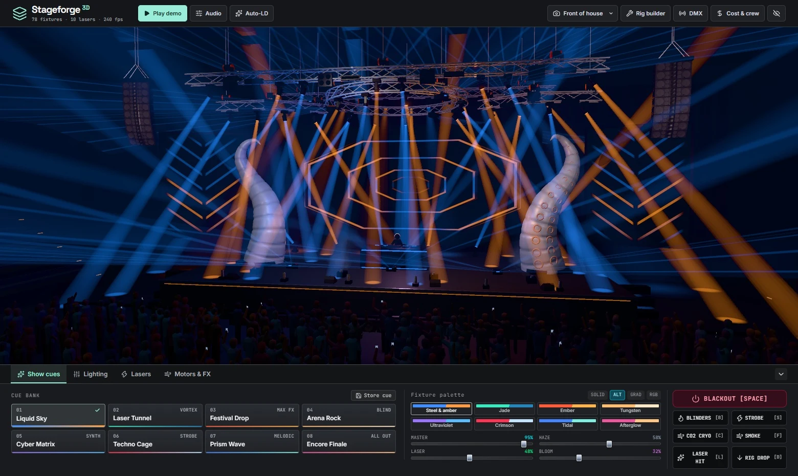

# StageForge 3D

StageForge is a browser-based concert simulator. Design a stage, light it from an eight-cue desk, and watch from seven cameras, including a close-up of the PA. The app uses React, Three.js and the Web Audio API.

[Launch StageForge in your browser](https://jbrick2070.github.io/stageforge/)



## Run locally

Use Node.js 22.12 or later and a browser with WebGL 2 enabled. From the project directory, run

```sh
npm ci
npm run dev
```

Open the local URL printed by Vite. The default is [127.0.0.1:5173](http://127.0.0.1:5173/).

Run `npm test` to check rig compatibility, deck surfaces and truss patching. To compile the TypeScript and build a production copy, run `npm run build`. Run `npm run preview` to inspect the generated site locally.

## Build a stage

Choose **Design stage** beside Play to open the plan view. Start a blank design or edit the current rig. Draw deck modules at different heights to make platforms, wings and runways. Click points to draw a truss, then finish the path. Move its vertices to change the span or corners. The plan uses metres, with the audience downstage.

**Apply design** builds the 3D stage from the drawing. Open **Rig builder** to equip the trusses with lights, set their motors, add floor effects and place PA or scenery. Apply saves the latest design on this browser. Subsequent equipment changes are saved with it. **Open saved design** in Rig builder recalls that copy. Export named rig JSON files to keep several designs or open them on another device. The arena, festival, warehouse and starter rigs are also available as starting points.

- Under **Inflatables & stage props**, add a tentacle, foil star, arch, marquee tower or performance riser. Select a placed piece to change its color, position, size and rotation.
- Configure the PA with **Flown boxes per side**, **Monitor wedges** and **Subwoofers**. Each flown array supports 4–12 cabinets, the deck supports up to eight monitor wedges, and the sub wall supports 2–16 cabinets in pairs.
- The arena and festival rigs use original 3D models sized to L-Acoustics’ published cabinet dimensions. **Speaker system** also offers a generic touring rig. The PA models provide a visual reference. The production budget uses illustrative prices. Manufacturer specifications are available for the [K2 array](https://www.l-acoustics.com/products/k2/), [KS28 subwoofer](https://www.l-acoustics.com/products/ks28/) and [X12 monitor](https://www.l-acoustics.com/products/x12/).
- Use the download and upload buttons at the top of **Rig builder** to save and restore a rig as JSON. The file includes scenery and speaker settings.

The plan format, fixture attachment rules and rendering flow are described in [Stage design architecture](docs/stage-design.md).

## Run a show

The stage opens in blackout. To preview the rig before playback, open **Rig builder**, select a camera or tap a cue. **Play demo** starts the concert from black even after a preview.

1. Press **Play demo**. At the default 128 BPM, the stage stays completely dark for two bars (3.75 seconds). A pair of amber backlights fades up in bars 3–4. More beams join in bars 5–6, followed by washes in bars 7–8. The video walls ease in during the groove, and lasers enter during the build. The first full-rig hit lands at 0:45. The breakdown at 1:00 leads into a second build, the finale at 1:30 and a curtain call at the end of the two-minute set. **Pause** holds your place and **Replay demo** repeats the opening blackout. Open **Audio** to change tempo, load your own track or use a microphone.
2. To run the opening again at any point, choose **Audio → Restart demo**. If a track or microphone is active, choose **Audio → Return to demo**. Select a pad in **Show cues** for an immediate lighting change. To save a look for this session, choose **Store cue** and then a destination pad.
3. **Auto-LD** follows the demo score from the first bar. Select a cue or edit a fixture to take over the lights while the music continues. Turn **Auto-LD** back on to rejoin the current phrase. The master dimmer, blackout, camera and momentary effects stay under your control.
4. Open **DMX** to inspect simulated channel values and fixture patches in either 512-channel universe. **Cost & crew** shows an illustrative production estimate for the current rig.

| Keyboard | Action |
| --- | --- |
| Space | Toggle blackout |
| B / S | Hold blinders / strobe |
| C / F | Hold CO₂ / smoke |
| L / D | Hold laser hit / rig drop |
| 1–6 | Select show camera |
| 7 | Inspect the PA up close |
| H | Toggle cinema mode |

## Xbox controller

Connect a standard-mapped Xbox controller by USB or Bluetooth, focus the show, and press a button to connect. Open **Controller** on the stage for its connection status and bindings. If the browser asks for an audio gesture, click **Play demo** once.

| Controller | Action |
| --- | --- |
| A | Play, pause, resume or replay |
| D-pad left / right | Previous / next cue |
| D-pad up / down | Raise / lower the master by 5 percentage points |
| LB / RB | Previous / next camera |
| Right stick | Orbit the camera |
| B / X / Y | Hold blinders / laser hit / CO₂ |
| LT / RT | Hold smoke / strobe |
| View / Menu | Toggle Auto-LD / cinema mode |

## License

[MIT](LICENSE)
